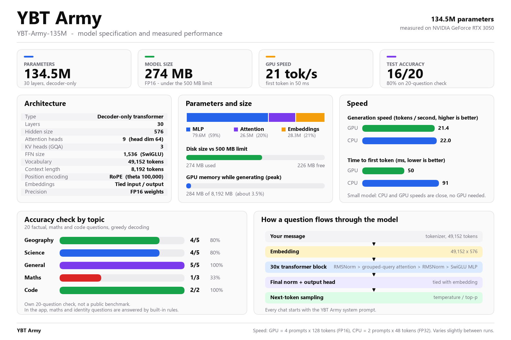

<p align="center">
  
</p>

<p align="center">
  A compact 135M-parameter AI assistant with a clean chat UI.<br>
  Runs offline on a normal laptop once installed, in under 300&nbsp;MB.
</p>

<p align="center">
  <a href="#quick-start">Quick start</a> &nbsp;·&nbsp;
  <a href="#features">Features</a> &nbsp;·&nbsp;
  <a href="#how-it-works">How it works</a> &nbsp;·&nbsp;
  <a href="#model-at-a-glance">Model</a> &nbsp;·&nbsp;
  <a href="#limitations">Limitations</a>
</p>

---

## Demo

<p align="center">
  
</p>

## Features

- **Private and offline.** After the one-time install, the model runs on your own machine. No account, no API key, and your chats never leave your computer.
- **Small.** 134.5M parameters, 274&nbsp;MB on disk in FP16. Peak GPU memory while generating is about 284&nbsp;MB.
- **Fast enough to feel instant.** About 21 tokens per second and a 50&nbsp;ms first token on an RTX 3050. A normal CPU gives similar speed.
- **Clean chat UI.** White and black theme with dark mode that follows your device. Works on desktop and phone, with streaming replies and small, calm animations.
- **Saved chats.** Search, reopen and delete conversations. Everything is stored in one local JSON file.
- **Useful controls.** Regenerate, copy a reply, export a chat to Markdown, and switch reply style between Balanced, Concise, Detailed and Hinglish.
- **Exact answers where it matters.** Arithmetic, greetings and "who are you" questions are answered by built-in rules, so they are never wrong.

## Quick start

### Windows (one click)

Double-click **`run_you_b_tech.bat`**. On the first run it creates a virtual environment and installs the packages, then opens the app at <http://localhost:8501>.

### Manual

```bash
python -m venv .venv
.venv\Scripts\activate          # macOS / Linux: source .venv/bin/activate
pip install -r requirements.txt
streamlit run ybt_app.py
```

Python 3.9 or newer. A GPU is optional.

### Model weights

The weights live in `YBT-Army-135M/model.safetensors` (269&nbsp;MB), which is above GitHub's normal 100&nbsp;MB file limit. This repository tracks `*.safetensors` with **Git LFS** (see `.gitattributes`):

```bash
git lfs install
git clone <this-repo-url>
```

If you download the repository as a ZIP, copy the `YBT-Army-135M/` folder in separately.

## How it works

<p align="center">
  
</p>

1. Your message is wrapped in a chat template that starts with the YBT Army system prompt.
2. The tokenizer turns it into tokens, and a 30-layer transformer predicts the next token again and again.
3. Tokens are streamed back into the chat as soon as they are produced.

Maths, greetings and identity questions are caught first by small rules in `ybt_app.py`, so they skip the model entirely.

## Model at a glance

<p align="center">
  
</p>

| | |
|---|---|
| Parameters | 134.5M |
| Layers / hidden size | 30 / 576 |
| Attention | 9 heads, 3 key-value heads (grouped-query) |
| Feed-forward | SwiGLU, 1,536 |
| Vocabulary | 49,152 tokens |
| Context length | 8,192 tokens |
| Precision | FP16 weights, 274 MB on disk |

Speed and accuracy were measured on an NVIDIA GeForce RTX 3050 (8 GB). Accuracy is a small 20-question check of my own (16 / 20 correct, scored on the first line of each answer). It is **not** a public benchmark, so treat it as a rough guide.

## Settings

Open **Preferences** in the sidebar:

| Setting | What it does |
|---|---|
| Dark mode | Follows your device on first visit, then remembers your choice for the session |
| Style | Balanced, Concise, Detailed or Hinglish replies |
| Creativity | Lower is more precise, higher is more varied |
| Max reply length | Upper limit on tokens per reply |
| Memory | How many earlier messages the model sees |

Chats are saved to `chats/chats.json`. Set the `YBT_CHATS_DIR` environment variable to store them somewhere else.

## Project structure

```text
.
├── YBT-Army-135M/        model weights, tokenizer and chat template
├── assets/               README graphics (animated SVG + spec sheet)
├── .streamlit/           UI theme
├── ybt_app.py            the chat app
├── ybt_brand.py          name, system prompt and chat template
├── requirements.txt
├── run_you_b_tech.bat    one-click launcher for Windows
└── NOTICE.md             third-party licences
```

## Limitations

Be realistic about a 135M-parameter model.

- It can state wrong facts with confidence. Double-check anything important.
- Maths in free text is weak. Simple arithmetic is handled by rules, but word problems often fail.
- Replies in Hindi or Hinglish are rougher than in English.
- Long, multi-step reasoning and long documents are beyond its size.

## Credits and licence

YBT Army is built and maintained by the YBT Army team. The model is derived from open-source weights, and the licence terms require a notice to travel with copies of the model. Please keep **[`NOTICE.md`](NOTICE.md)** when you share or publish this project.
